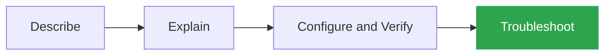

# Network Troubleshooting Labs

**Hands-on troubleshooting scenarios built in Cisco Modeling Labs (CML)**

Each lab starts with a broken network. I document how I found each fault, why it happened, and how I fixed and verified it.

---

## Why Troubleshooting?

The best way to show expertise in a field is to troubleshoot it. The verbs in Cisco's exam topics show how deeply you need to know each subject, from least to most in depth:

Troubleshooting is at the top because it takes the deepest understanding. You have to know what causes an issue, what a protocol needs in order to work, and which show and debug commands will prove it. That's why I chose troubleshooting to show what I know.

> [!NOTE]
> **Lab Sources:** Labs come from YouTube creators (such as Kevin Wallace), books, and scenarios I build myself. Each lab's README credits its source.

---

## Scenarios

| # | Scenario | Topics | Faults | Difficulty | Source |
|:-:|---|---|:-:|:-:|---|
| 01 | [**Multi-Area OSPF**](01-ospf-multi-area/) | Adjacencies, MTU, cost, virtual links | 3 |  | Kevin Wallace |

---

## How Each Lab Is Organized

| File | What It Is |
|---|---|
| `README.md` | The full troubleshooting walkthrough, with commands and screenshots |
| `.yaml` | The CML lab file. Import it to try the lab yourself |

## Tools

- **Cisco Modeling Labs (CML)**
- **Cisco IOSv** routers
- **Alpine Linux** hosts

---

## About Me

**Abdulrahman (Abdu) Mohammed**

CCNA certified and working toward the CCNP.

